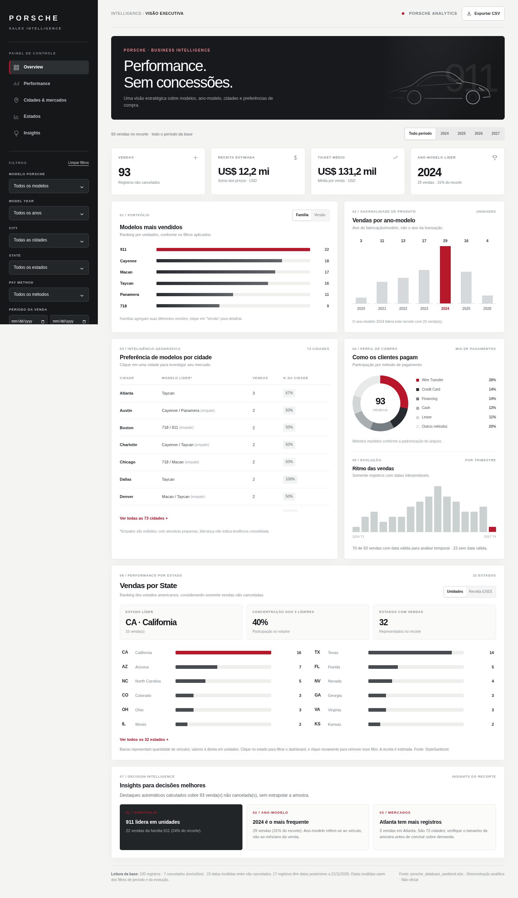
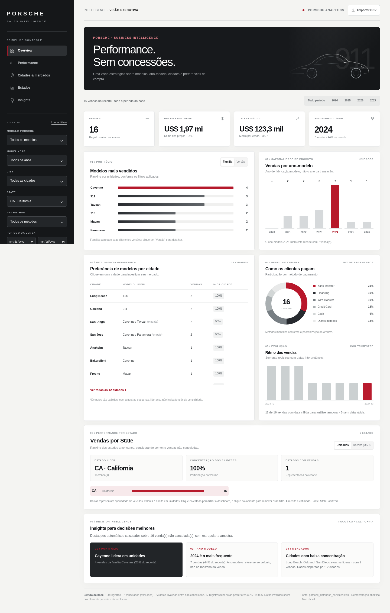

# Porsche Sales Intelligence 🏎️

**Dashboard interativa de vendas da Porsche, construída com HTML, CSS, JavaScript e apoio de IA.** O projeto transforma uma planilha sanitizada de 100 registros em indicadores, rankings e insights de negócio, com filtros dinâmicos e uma interface inspirada no design da Porsche Brasil.

[](https://developer.mozilla.org/pt-BR/docs/Web/HTML)
[](https://developer.mozilla.org/pt-BR/docs/Web/CSS)
[](https://developer.mozilla.org/pt-BR/docs/Web/JavaScript)
[](https://diegofloriano.github.io/dashboard_porsche_sales/)

**[🚀 Acessar a dashboard online](https://diegofloriano.github.io/dashboard_porsche_sales/)** · **[📂 Ver o repositório](https://github.com/diegofloriano/dashboard_porsche_sales)**

## 📸 Preview



**Exemplo de filtro aplicado — State: California (CA)**



> Os prints mostram os dados de demonstração fornecidos no desafio. A dashboard não é um painel oficial da Porsche.

## 🎯 Objetivo

Projeto desenvolvido para o desafio **“Criando uma Dashboard da Porsche com Agentes de IA”**, da [DIO](https://www.dio.me/). O objetivo é transformar dados de vendas em informações úteis à tomada de decisão, indo além de apenas exibir gráficos: cada visualização responde a uma pergunta de negócio.

### As três perguntas de negócio

| Pergunta | Como a dashboard responde | Valor para o negócio |
| --- | --- | --- |
| **1. Quais modelos Porsche são mais vendidos por cidade?** | Ranking por família/versão, tabela de modelos líderes por cidade e insights locais. | Identificar preferências regionais e orientar análises de portfólio. |
| **2. Qual ano-modelo teve mais vendas em determinado período?** | Gráfico de vendas por *Model Year*, combinado com filtro de intervalo de datas da transação. | Comparar a procura por diferentes anos-modelo ao longo do tempo. |
| **3. Quais estados concentram mais vendas e receita?** | Gráfico **Vendas por State**, com alternância entre unidades e receita (USD), ranking e seleção de estado. | Identificar a distribuição geográfica dos resultados e comparar mercados. |

**Análises complementares:** receita estimada, ticket médio, métodos de pagamento, evolução trimestral e insights automáticos de acordo com os filtros selecionados.

## 📊 Principais resultados da base

| Indicador | Resultado sem filtros |
| --- | ---: |
| Registros na planilha | 100 |
| Vendas não canceladas | **93** |
| Receita estimada das vendas não canceladas | **US$ 12.202.550,50** |
| Família mais vendida | **911 — 22 veículos** |
| Ano-modelo mais frequente | **2024 — 29 veículos** |
| Estado com maior volume | **California (CA) — 16 veículos** |
| Segundo estado em volume | **Texas (TX) — 14 veículos** |

Esses valores representam **a amostra do desafio**, não estatísticas oficiais de vendas da Porsche. A receita é uma soma dos preços registrados e não representa necessariamente faturamento realizado: registros não cancelados podem estar pendentes de entrega.

## 🧹 Preparação e qualidade dos dados

A planilha disponibilizada pela DIO contém dados originais e suas versões sanitizadas. Para a dashboard, foram utilizadas as colunas:

- `SaleDateSanitized`, `PorscheModelSanitized` e `ModelYearSanitized`;
- `CitySanitized`, `StateSanitized` e `PayMethodSanitized`;
- `SalesPriceSanitized` e `DeliveryStatusSanitized`.

**Tratamentos e decisões:**

1. Utilização dos campos sanitizados, com modelos, cidades, estados e formas de pagamento padronizados.
2. Conversão do preço de venda para valor numérico e padronização do ano-modelo para agrupamentos e filtros.
3. Exclusão dos **7 registros com status `Cancelled`** dos KPIs de venda e receita.
4. Identificação de **23 registros não cancelados com data `INVALID`**: eles participam dos totais gerais, mas ficam fora das análises e filtros que exigem data válida.
5. Preservação dos estados informados em `StateSanitized`, em vez de tentar deduzi-los a partir da cidade.
6. Incorporação dos dados necessários ao JavaScript dentro do próprio `index.html`, sem necessidade de API ou servidor de dados.

**Limitação importante:** a amostra contém datas posteriores a 21/11/2026 e cidades com poucos registros. Por isso, os padrões apresentados são exploratórios e não devem ser interpretados como previsões ou tendências consolidadas.

## 🧰 Tecnologias e recursos

- **HTML5:** estrutura da aplicação em uma única página.
- **CSS3:** layout responsivo, navegação lateral, cards, gráficos e paleta refinada inspirada no [site oficial da Porsche Brasil](https://www.porsche.com/brazil/pt/).
- **JavaScript (Vanilla JS):** filtros combinados, agregações, geração de gráficos, indicadores e insights sem bibliotecas externas.
- **ChatGPT:** apoio à criação e ao refinamento da dashboard em linguagem natural.
- **GitHub Pages:** hospedagem estática gratuita.

### Funcionalidades

- Filtros por **modelo Porsche, Model Year, City, State, Pay Method e período de venda**;
- Atualização dos KPIs e gráficos conforme o recorte selecionado;
- Alternância entre **família de modelos** e **versões individuais**;
- Comparação de estados por **unidades ou receita** e filtro ao clicar no estado;
- Seleção de cidades na tabela para aprofundar a análise;
- **Exportação CSV** do conjunto de dados filtrado;
- Layout adaptável a desktop e dispositivos móveis.

## 🤖 Como a IA foi utilizada

O projeto foi desenvolvido com **ChatGPT**, por meio da geração de HTML e de refinamentos solicitados em linguagem natural. A solicitação inicial mencionava o recurso Canvas do curso; **não foi utilizado um agente próprio com skill personalizada** nesta implementação.

### Prompt inicial (resumo da solicitação)

> Crie uma dashboard em HTML baseada na planilha de vendas da Porsche, com filtros por modelo, ano-modelo, cidade e método de pagamento. Responda quais modelos são mais vendidos por cidade, qual ano-modelo lidera em um período e apresente insights sobre a popularidade dos veículos em cada cidade. Use o site oficial da Porsche Brasil como referência de UI/UX, com aparência elegante e refinada.

### Refinamento realizado

> **Pergunta 3:** crie um gráfico de vendas por **State**.

A partir desse refinamento, a dashboard passou a oferecer uma seção de desempenho por estado com ranking, receita em USD, volume de unidades e seleção interativa de estados. Também foi incorporado o filtro `State`, integrado aos demais indicadores.

**Aprendizado:** fornecer perguntas de negócio claras e iterar sobre os resultados da IA produz um painel mais útil do que solicitar apenas uma visualização genérica da planilha.

## ▶️ Como executar

Não é necessário instalar dependências ou executar um servidor.

1. Faça o clone deste repositório:

   ```bash
   git clone https://github.com/diegofloriano/dashboard_porsche_sales.git
   ```

2. Entre na pasta:

   ```bash
   cd dashboard_porsche_sales
   ```

3. Abra `index.html` no navegador **ou acesse a versão online**:

   https://diegofloriano.github.io/dashboard_porsche_sales/

O dashboard funciona como uma página estática. Os dados de demonstração estão incorporados ao arquivo HTML.

## 📁 Estrutura do projeto

```text
dashboard_porsche_sales/
├── index.html                  # Dashboard interativa
├── README.md                   # Documentação do projeto
└── assets/
    ├── dashboard-preview.png   # Captura da dashboard completa
    └── filtro-california.png   # Exemplo com o filtro State = CA
```

## 🚀 Publicação

A aplicação está publicada via **GitHub Pages**, a partir do arquivo `index.html` na branch `main`.

- **Dashboard:** https://diegofloriano.github.io/dashboard_porsche_sales/
- **Repositório público:** https://github.com/diegofloriano/dashboard_porsche_sales

## 📚 Referências

- [DIO — Plataforma de aprendizagem](https://web.dio.me/)
- [Porsche Brasil — referência visual](https://www.porsche.com/brazil/pt/)
- [GitHub Pages — documentação](https://docs.github.com/pt/pages)

---

**Desenvolvido por [Diego Floriano](https://github.com/diegofloriano)** · Projeto educacional de análise de dados com IA, sem vínculo com a Porsche AG.
